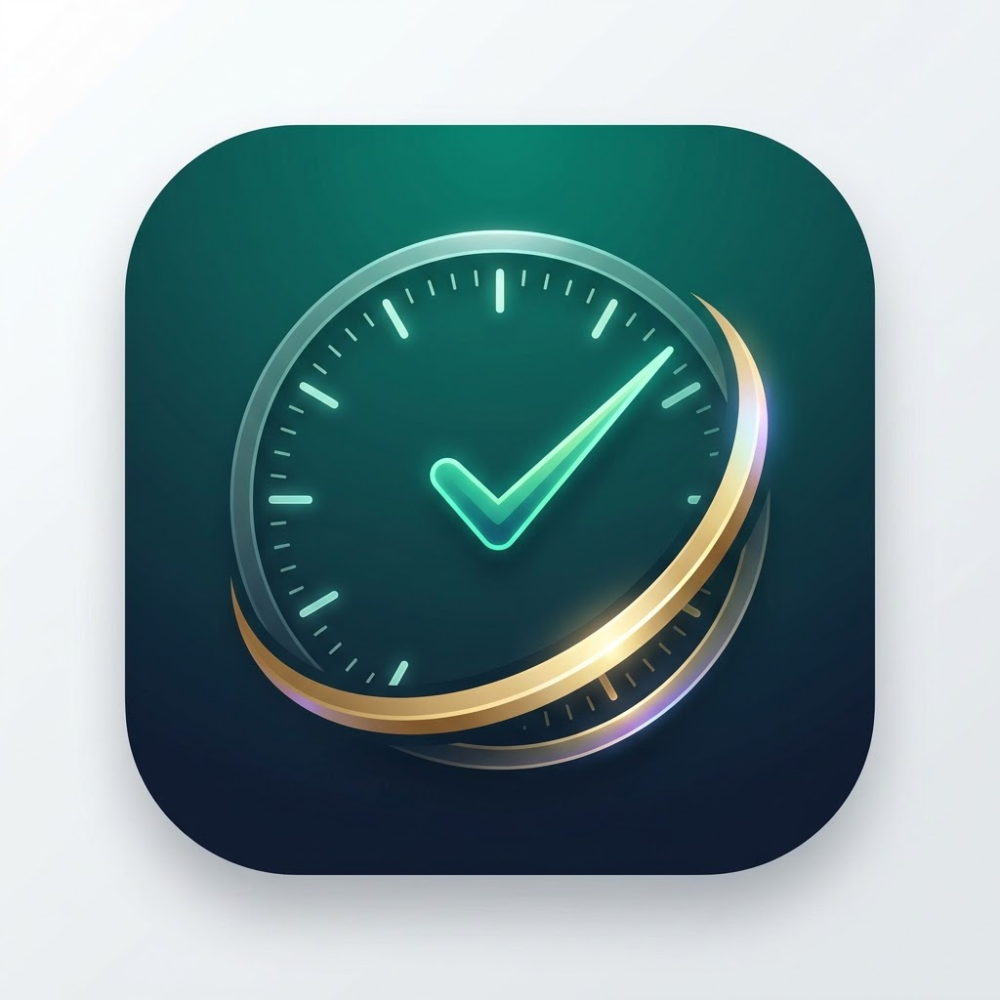

<div align="center">

  

  # ورديتي | Wardiaty
  
  **دفتر الحضور والانصراف والورديات الذكي وحساب المستحقات اليومية والشهرية**
  
  *Smart, Offline-First Attendance & Shift Tracker with Automated Payroll and Overtime Calculations*

  <br/>

  [](https://flutter.dev)
  [](https://dart.dev)
  [](https://github.com/Sherif42022028/Wardiaty)
  [-FF9800?style=for-the-badge)](https://pub.dev/packages/hive)
  [-E91E63?style=for-the-badge)](https://github.com/Sherif42022028/Wardiaty)
  [](LICENSE)

  <br/>

  ### 📱 [📥 اضغط هنا لتحميل تطبيق الأندرويد مباشرة (Download APK)](wardiaty-release.apk)

</div>

---

## 📖 جدول المحتويات
- [عن التطبيق](#-عن-التطبيق)
- [المميزات الرئيسية](#-المميزات-الرئيسية)
- [تثبيت واستخدام التطبيق](#-تثبيت-واستخدام-التطبيق)
- [دليل المطورين والتشغيل المحلي](#-دليل-المطورين-والتشغيل-المحلي)
- [بناء حزم الإنتاج](#-بناء-حزم-الإنتاج)
- [هيكل المشروع المعماري](#-هيكل-المشروع-المعماري)
- [الخصوصية والأمان](#-الخصوصية-والأمان)
- [الترخيص](#-الترخيص)

---

## 🌟 عن التطبيق

**ورديتي** هو تطبيق عربي متكامل مصمم خصيصاً للعمال، الفنيين، المهندسين، وموظفي الورديات في المصانع والشركات والمؤسسات. يساعدك التطبيق في ضبط وتسجيل حضورك اليومي وانصرافك، وحساب ساعات العمل الفعلية، ساعات الإضافي، ساعات العجز، وإدارة السلف والخصومات والمكافآت، واستخراج تقارير شهرية مفصلة جاهزة للطباعة والمشاركة بكل دقة وبدون الحاجة لأي اتصال بالإنترنت.

---

## 🚀 المميزات الرئيسية

### ⏱️ تسجيل ذكي للورديات وساعات العمل
- **تسجيل فوري للحضور والانصراف:** إمكانية تسجيل الدخول والخروج بنقرة زر واحدة أو التعديل اليدوي في أي وقت.
- **مؤقت حي في الشاشة الرئيسية:** ساعة رقمية حية تعرض حالة الوردية الحالية، والوقت المنقضي بدقة.
- **دعم الورديات الليلية:** معالجة دقيقة للورديات التي تمتد عبر منتصف الليل (Overnight shifts).
- **حالات متعددة لليوم:** (يوم عمل، إجازة مدفوعة، إجازة بدون أجر، غياب، عطلة أسبوعية).

### ➕ حساب آلي للإضافي والعجز
- مقارنة ساعات العمل الفعلية بساعات الوردية القياسية تلقائياً.
- حساب ساعات الإضافي (Overtime) وساعات العجز (Undertime) مع تطبيق معاملات الاحتساب القابلة للتخصيص من الإعدادات.

### 💰 إدارة مالية مبسطة (السلف، الجزاءات، والمكافآت)
- تسجيل السلفيات والخصومات والجزاءات يوماً بيوم.
- إضافة الحوافز والمكافآت.
- احتساب فوري وصافي لمستحقات اليوم والشهر بالكامل مع الراتب الأساسي وسعر الساعة.

### 📊 تقارير شهرية وإحصائيات تفاعلية
- ملخص شهري شامل يتضمن:
  - إجمالي ساعات العمل الفعلية، الإضافي، والعجز.
  - عدد أيام الحضور والغياب والإجازات.
  - تفقيط الحساب المالي (الأساسي + الإضافي + المكافآت - السلف والخصومات = صافي المستحق).
- رسوم بيانية ومؤشرات مرئية واضحة لحركة الورديات طوال الشهر.

### 📄 تصدير وطباعة احترافية (PDF & CSV)
- **تقارير PDF باللغة العربية:** مستندات منسقة وجاهزة للطباعة أو الإرسال الفوري لجهات العمل والمحاسبين عبر WhatsApp أو البريد.
- **تصدير شيت CSV:** ملفات متوافقة بالكامل مع برامج الجداول الإلكترونية مثل Microsoft Excel و Google Sheets.

### 🔒 خصوصية تامة وحفظ محلي (Offline-First)
- التطبيق يعمل بنسبة **100% دون الحاجة إلى إنترنت**، بياناتك تظل على جهازك ولا تُرسل لأي خادم خارجي.
- قاعدة بيانات محلية فائقة السرعة باستخدام [Hive](https://pub.dev/packages/hive).
- **نسخ احتياطي واستعادة كاملة:** تصدير نسخة احتياطية من كل بياناتك كملف JSON واستعادتها في ثوانٍ.

### 🎨 واجهة عصرية ومريحة للعين (Modern RTL Design)
- تجربة مستخدم مبنية بالكامل باللغة العربية مع مراعاة كاملة للاتجاه من اليمين لليسار (RTL).
- خط عربي عصري وواضح يسهل القراءة.
- لوحة ألوان هادئة ومتناسقة مصممة لتقليل إجهاد العين أثناء العمل.

---

## 📲 تثبيت واستخدام التطبيق

### تثبيت تطبيق الأندرويد (Android APK):
1. قم بتحميل ملف التثبيت المباشر من الرابط: [wardiaty-release.apk](wardiaty-release.apk).
2. افتح الملف على هاتفك الأندرويد.
3. إذا طلب هاتفك الإذن لتثبيت التطبيقات من مصادر غير معروفة، اضغط على **السماح** (Allow from this source).
4. اضغط على **تثبيت (Install)**، وسيظهر التطبيق بأيقونته الرسمية على شاشتك الرئيسية فوراً.

---

## 💻 دليل المطورين والتشغيل المحلي

إذا كنت مطوراً وترغب في تشغيل المشروع محلياً أو التعديل عليه:

### المتطلبات الأساسية:
- [Flutter SDK](https://docs.flutter.dev/get-started/install) (الإصدار `>= 3.11.0`)
- [Dart SDK](https://dart.dev/get-dart)
- محاكي أندرويد، هاتف متصل، أو متصفح Google Chrome.

### خطوات التشغيل:
1. **استنساخ المستودع (Clone):**
   ```bash
   git clone https://github.com/Sherif42022028/Wardiaty.git
   cd Wardiaty
   ```

2. **تثبيت الحزم والمكتبات:**
   ```bash
   flutter pub get
   ```

3. **تشغيل الفحص والتأكد من سلامة الكود:**
   ```bash
   flutter analyze
   ```

4. **تشغيل اختبارات الوحدة (Unit Tests):**
   ```bash
   flutter test
   ```

5. **تشغيل التطبيق في وضع التطوير (Debug):**
   - على الهاتف أو المحاكي:
     ```bash
     flutter run
     ```
   - كنسخة ويب على المتصفح:
     ```bash
     flutter run -d chrome
     ```

---

## 📦 بناء حزم الإنتاج

- **بناء ملف الـ APK للأندرويد (Release APK):**
  ```bash
  flutter build apk --release
  ```
  *سيتواجد الملف الناتج في المسار:* `build/app/outputs/flutter-apk/app-release.apk`

- **بناء حزمة الويب (Web Release):**
  ```bash
  flutter build web --release
  ```
  *سيتواجد مجلد الويب الجاهز للنشر في المسار:* `build/web/`

---

## 🏗️ هيكل المشروع المعماري

المشروع مبني بهيكل معماري نظيف ومنظم يسهل الصيانة والتطوير:

```text
lib/
├── main.dart                  # نقطة انطلاق التطبيق وتهيئة Hive والسمات
├── models/                    # نماذج البيانات (DayLog, ShiftSettings, SalaryProfile, MonthlySummary)
│   ├── day_log.dart
│   ├── day_status.dart
│   ├── monthly_summary.dart
│   ├── salary_profile.dart
│   └── shift_settings.dart
├── providers/                 # إدارة الحالة المركزية (ChangeNotifier / Provider)
│   └── attendance_provider.dart
├── screens/                   # شاشات التطبيق الرئيسية
│   ├── daily_tracker_screen.dart   # شاشة تسجيل اليومية والحضور
│   ├── home_dashboard_screen.dart  # لوحة التحكم الرئيسية والساعة الحية
│   ├── monthly_report_screen.dart  # شاشة التقارير الشهرية والتصدير
│   └── settings_screen.dart        # شاشة إعدادات الورديات والراتب والنسخ الاحتياطي
├── services/                  # طبقة الخدمات المحلية وقاعدة البيانات
│   ├── backup_service.dart         # خدمة النسخ الاحتياطي والاستعادة JSON
│   ├── export_service.dart         # خدمة إنشاء ملفات PDF و CSV
│   └── storage_service.dart        # خدمة إدارة صناديق Hive
├── theme/                     # نظام الألوان والسمة العامة
│   └── app_theme.dart
├── utils/                     # دوال المساعدة وتنسيق الأوقات والعملات
│   ├── arabic_numbers.dart
│   ├── calculations.dart
│   └── date_formatters.dart
└── widgets/                   # مكونات واجهة المستخدم القابلة لإعادة الاستخدام
    ├── app_bottom_nav.dart
    ├── attendance_quick_card.dart
    ├── day_form_card.dart
    ├── digital_clock_card.dart
    ├── export_modal_bottom_sheet.dart
    ├── recent_days_list.dart
    ├── salary_profile_card.dart
    ├── shift_config_card.dart
    └── stats_overview_card.dart
```

---

## 🛡️ الخصوصية والأمان

- **لا تتبع ولا إعلانات:** التطبيق لا يحتوي على أي حزم تتبع تحليلي أو إعلانات.
- **تخزين محلي 100%:** كافة سجلاتك المالية واليومية مخزنة حصرياً على ذاكرة جهازك.
- **تحكم كامل في بياناتك:** يمكنك أخذ نسخة احتياطية من كل بياناتك وحفظها أو حذفها في أي وقت بدون أي قيود.

---

## 📜 الترخيص (License)

هذا المشروع مرخص تحت رخصة **MIT** - راجع ملف [LICENSE](LICENSE) للمزيد من التفاصيل.

---

<div align="center">
  <b>تم التطوير بكل إتقان لخدمة كل عامل وموظف يبحث عن الدقة وراحة البال 💼⏱️</b>
</div>
